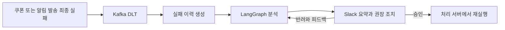

<div align="center">

# 선착순 판매와 행동 데이터 마케팅 플랫폼

커머스에서 일어나는 구매, 조회, 장바구니 같은 고객 행동을 수집해 쿠폰과 알림 캠페인, 성과 분석에 쓰는 마케팅 파이프라인입니다.<br>
그중 트래픽이 가장 몰리는 선착순 판매를 안정적으로 처리하는 데 집중했습니다.


<sub>선착순 상품 응모부터 결제 완료까지. 결제가 확정되면 Kafka를 거쳐 처리 서버가 구매를 기록합니다.</sub>

</div>

---

**목차**

- [주요 기능](#주요-기능)
- [시스템 구조](#시스템-구조)
- [성능 개선 결과](#성능-개선-결과)
- [기술적으로 집중한 문제](#기술적으로-집중한-문제)
- [기술 스택](#기술-스택)
- [실행 방법](#실행-방법)

---

## 주요 기능

### 1. 선착순 구매

몰리는 응모를 Redis에서 원자적으로 판정하고, 결제가 끝나면 나머지 처리는 Kafka로 넘겨 바로 응답합니다. 운영자는 남은 재고와 방문부터 결제까지의 퍼널을 실시간으로 봅니다.

<p align="center">

</p>

### 2. 행동 기반 마케팅

JS SDK와 서버에서 모은 행동 로그로 대상을 골라 쿠폰과 알림을 보냅니다. 캠페인 안에서는 세그먼트, 장바구니 이탈, 휴면 고객에게 쿠폰을 보내고, 캠페인 밖에서는 행동 규칙을 만족한 고객에게 쿠폰이나 알림을 자동으로 보냅니다.

<table>
<tr>
<td width="50%" valign="top">
<a href="./docs/assets/screens/campaign-management.png"></a><br>
캠페인 관리: 활동별 상태, 정원 대비 참여, 예산
</td>
<td width="50%" valign="top">
<a href="./docs/assets/screens/customer-profile.png"></a><br>
고객 프로필: 구매와 쿠폰 이력, 행동 타임라인
</td>
</tr>
</table>

### 3. 캠페인 성과 분석

쿠폰으로 산 구매를 쿠폰, 발송 기록, 캠페인 순으로 따라가 캠페인 매출에 넣고 ROAS를 계산합니다. 쿠폰을 받지 않은 그룹(홀드아웃)과 비교해 쿠폰 때문에 늘어난 매출만 따로 봅니다.

<table>
<tr>
<td width="50%" valign="top">
<a href="./docs/assets/screens/overview.png"></a><br>
전체 캠페인 개요: 최근 30일 거래액과 캠페인별 ROAS
</td>
<td width="50%" valign="top">
<a href="./docs/assets/screens/incrementality.png"></a><br>
쿠폰 증분 효과: 받은 그룹과 받지 않은 그룹의 1인당 매출 비교
</td>
</tr>
</table>

### 4. 운영 AI 에이전트

대량 발송 전에 대상 수, 예산, 세그먼트가 맞는지 점검하고, 발송이 끝내 실패하면 이전 실패 이력과 함께 원인을 정리합니다. 관리자가 Slack에서 승인해야 발송하거나 다시 실행합니다(Human-in-the-Loop).

<p align="center">

</p>

<details>
<summary>발송 실패 분석 흐름</summary>



</details>

---

## 시스템 구조


**주문 흐름 (파랑)**
고객이 선착순 상품에 응모하면(A1) 요청 수신 서버가 Redis에서 중복 확인과 수량 차감을 원자적으로 판정합니다(A2). 결제가 끝나면 결제 완료 이벤트를 Kafka로 넘기고 바로 응답하며(A3), 처리 서버가 이를 받아 구매를 기록합니다(A4).

**마케팅 흐름 (주황)**
JS SDK가 조회, 클릭, 스크롤, 체류를 보내고 서버는 로그인과 구매를 보내 행동 로그로 모읍니다(B1). 행동 로그는 Kafka에서 Elasticsearch로 쌓이고(B2), 처리 서버가 여기서 발송 대상을 뽑고 캠페인 성과를 분석합니다(B3). 대량 발송은 운영 AI 에이전트가 먼저 검토하고(B4), 관리자가 Slack에서 승인해야 나갑니다(B5).

**서버를 늘려도 깨지지 않게 만든 장치**

현재는 VM 한 대에서 Docker Compose로 운영하지만, 두 서버 모두 여러 대로 늘려도 결과가 달라지지 않도록 만들었습니다.

| 장치 | 막는 문제 |
|---|---|
| Redis 원자적 재고 판정 (Lua) | 요청 수신 서버가 여러 대여도 정원을 넘겨 팔지 않음 |
| 스케줄러 분산 락 (Redisson) | 처리 서버를 늘려도 쿠폰과 휴면 고객 작업이 두 번 돌지 않음 |
| Kafka Consumer Group | 처리 서버 여러 대가 메시지를 나눠 받고, 한 메시지는 한 곳에서만 처리 |
| 멱등 처리 | 같은 메시지가 다시 와도 기록이나 발송이 중복되지 않음 |

---

## 성능 개선 결과

<table>
<tr>
<td align="center" width="20%"><h3>63%</h3></td>
<td align="center" width="20%"><h3>p95 500ms</h3></td>
<td align="center" width="20%"><h3>80%</h3></td>
<td align="center" width="20%"><h3>6배</h3></td>
<td align="center" width="20%"><h3>2.2배</h3></td>
</tr>
<tr>
<td align="center" valign="top">선착순 API p95 단축<br>Lua 원자 연산</td>
<td align="center" valign="top">1,000 RPS에서 유지<br>Virtual Thread, Kafka</td>
<td align="center" valign="top">트랜잭션 시간 단축<br>재고 지연 동기화</td>
<td align="center" valign="top">메시지 처리량<br>배치 소비</td>
<td align="center" valign="top">쿠폰 발급량<br>복합 인덱스</td>
</tr>
</table>

<sub>설계 기준: 선착순 구매 1,000 RPS (4 OCPU, 24GB, 한 대)</sub>

---

## 기술적으로 집중한 문제

- **선착순 동시 요청의 정합성과 응답 속도**: WATCH(낙관적 락)로 재고를 판정하니 충돌이 잦아 응답이 늦어졌습니다. Lua 스크립트로 구매자 등록과 수량 갱신을 원자적으로 처리해 정원 초과와 중복 구매를 막고 p95를 63% 줄였습니다.

  <details>
  <summary>자세히</summary>

  - **문제**: 선착순 구매 동시 요청에서 Redis WATCH 방식은 충돌한 요청이 재시도를 반복해 API 응답이 지연
  - **해결**: 중복 참여 확인, 수량 증가, 한도 초과 시 되돌리기를 Lua 스크립트 하나로 원자 처리. 트래픽이 몰리는 API에는 Virtual Thread를 적용하고 구매 이후 작업은 Kafka로 넘겨 바로 응답
  - **결과**: API p95 63% 단축, 초당 1,000건 요청에서 p95 500ms 유지

  </details>

- **결제 후처리의 Row Lock 경합**: 재고 차감이 특정 상품에 몰려 Row Lock 경합과 커넥션 풀 고갈이 생겼습니다. 재고 갱신을 트랜잭션에서 분리해 지연 동기화하고, 메시지는 배치로 소비하도록 바꿨습니다.

  <details>
  <summary>자세히</summary>

  - **문제**: 결제 후처리 트랜잭션 안에서 재고를 갱신해, 인기 상품에 Row Lock 경합과 커넥션 풀 고갈이 발생. 메시지마다 트랜잭션을 열어 소비가 밀리며 Consumer Lag 발생
  - **해결**: 재고 갱신을 트랜잭션에서 분리해 지연 동기화, 메시지를 배치로 소비하는 구조로 전환
  - **결과**: 트랜잭션 시간 80% 단축, 메시지 처리량 6배

  </details>

- **장바구니 이탈 쿠폰 대상 조회 병목**: 장바구니에 담고 30분이 지난 고객을 찾는 쿼리가 느려 발송이 밀렸습니다. EXPLAIN ANALYZE로 실행 계획을 보고 복합 인덱스를 맞춰 단위 시간당 발급량을 2.2배로 늘렸습니다.

- **대량 발송의 사람 실수**: 대상이나 예산 설정 실수가 그대로 수천 명에게 나갈 수 있었습니다. 발송 전 코드 점검과 LangGraph 에이전트의 요약을 Slack으로 보내, 관리자가 승인해야만 발송하도록 했습니다.

---

## 기술 스택

| | |
|---|---|
| **언어, 런타임** | Java 21, Virtual Thread, Spring Boot |
| **저장소** | MySQL, Redis, Elasticsearch |
| **메시징** | Kafka |
| **AI 에이전트** | FastAPI, LangGraph |
| **인프라** | Docker Compose, Oracle Cloud, GitHub Actions |
| **관측** | OpenTelemetry, Jaeger, Prometheus, Grafana |

---

## 실행 방법

```bash
cp .env.compose.example .env
docker compose -f compose.app.yml up -d --build
```

```bash
curl http://127.0.0.1:8080/actuator/health
curl http://127.0.0.1:8081/actuator/health
```

분석 파이프라인은 아래 compose 파일을 함께 사용합니다.

```bash
docker compose -f compose.app.yml -f compose.analytics.yml up -d
```

메트릭과 추적 화면은 아래 compose 파일을 함께 사용합니다.

```bash
docker compose -f compose.app.yml -f compose.metrics.yml -f compose.otel.yml up -d
```
