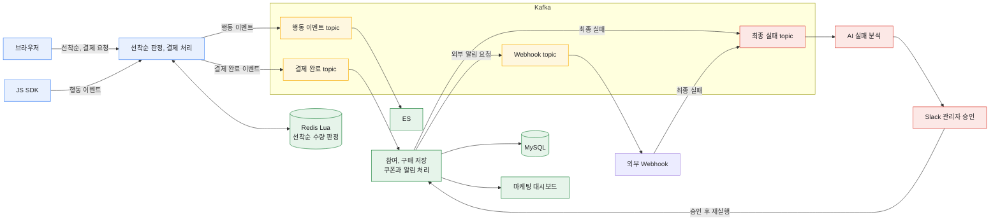
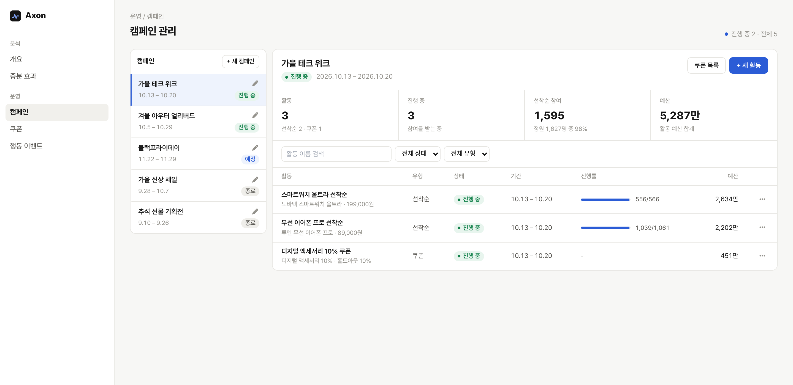
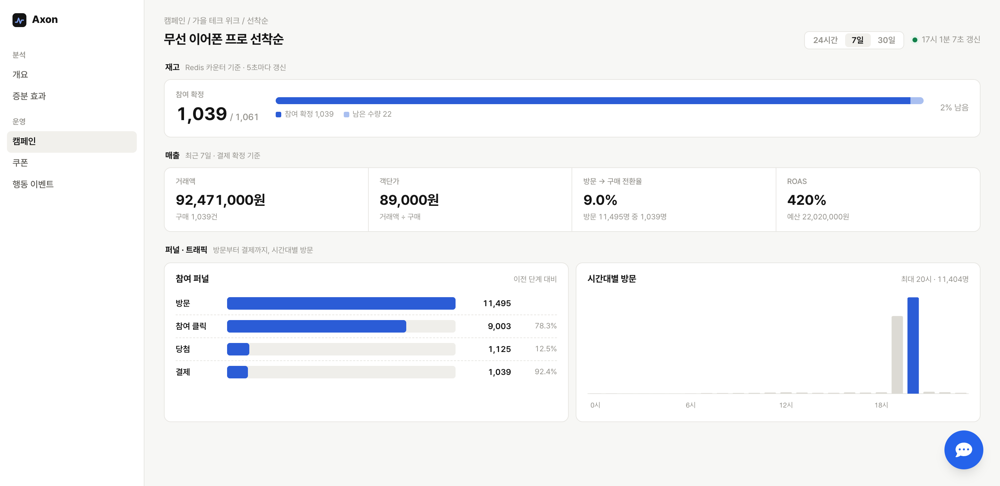
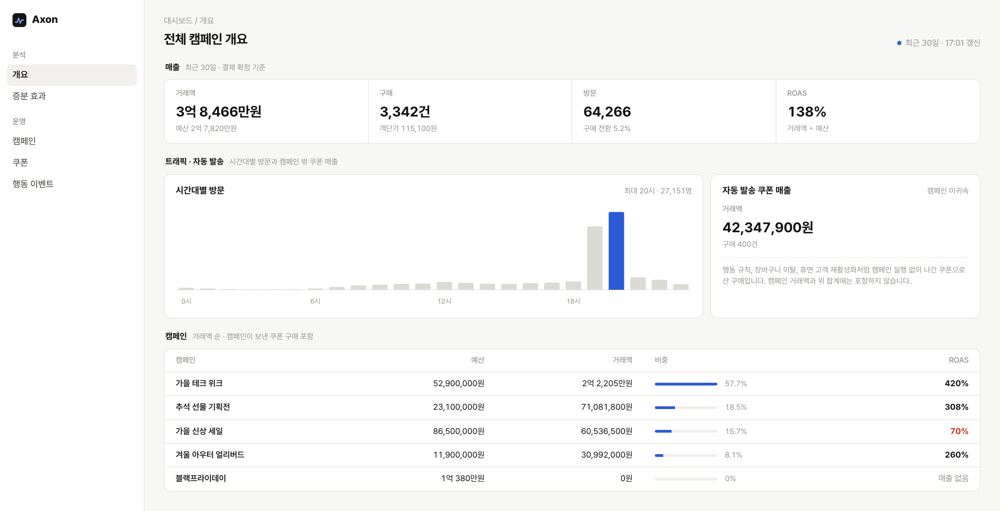
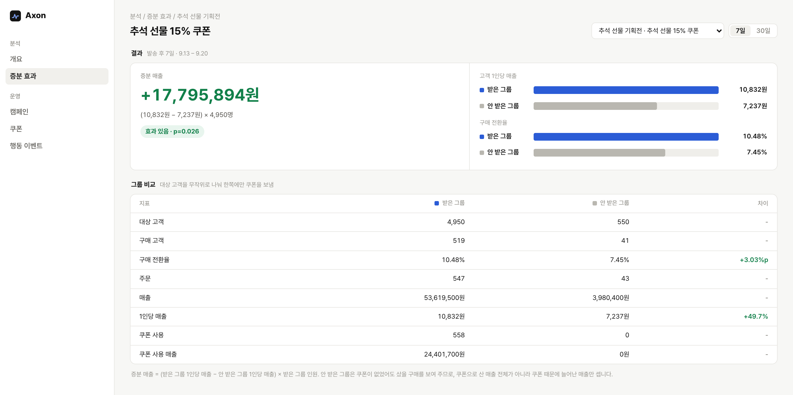
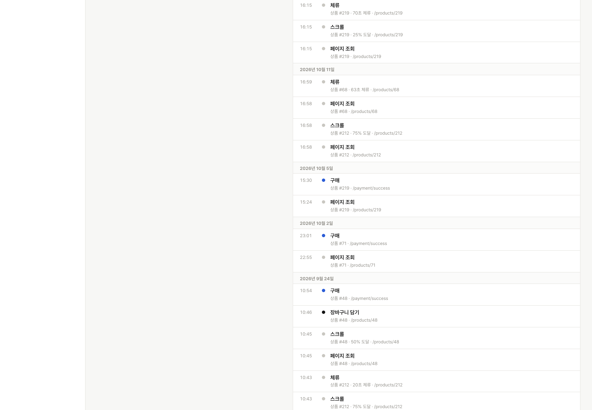
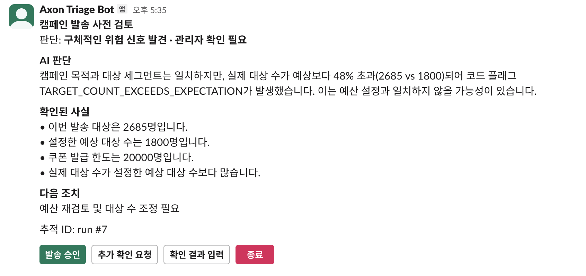
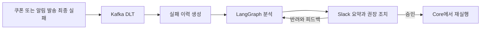

# 커머스 선착순 구매와 마케팅 파이프라인

선착순 이벤트 트래픽을 처리하고, 페이지 조회, 스크롤 깊이, 체류 시간, 구매 같은 행동 데이터를 수집해 마케팅 대시보드와 쿠폰, 알림 발송에 활용하는 프로젝트입니다.

주로 다룬 문제는 트래픽이 몰릴 때의 안정성, 선착순과 결제 기록의 정합성, 결제 이후 Kafka 비동기 후처리의 신뢰성입니다.

## 아키텍처

현재 Oracle VM 한 대에서 Docker Compose로 실행합니다. 요청을 빠르게 받는 서비스와 이후 데이터를 저장하고 활용하는 서비스를 나누고, 느린 외부 알림은 별도 Kafka topic으로 분리했습니다.



## 설계와 문제 해결

### 설계 이유

- **요청 수신 서비스와 후속 처리 서비스 분리**: 선착순 판정과 결제 처리는 바로 응답하고, 참여 기록, 구매 기록, 행동 로그, 쿠폰과 알림 처리는 Kafka를 통해 뒤에서 처리합니다.
- **Redis Lua 선착순 판정**: 중복 참여 확인, 수량 증가, 한도 초과 시 되돌리기를 한 번에 처리해 정원 초과 당첨을 막습니다.
- **Kafka 후속 처리**: 결제 완료 뒤 필요한 저장과 발송 작업을 요청 응답과 분리하고, 처리에 실패한 메시지는 다른 정상 메시지와 분리합니다.
- **Entry Virtual Thread**: 동시에 몰린 요청에서 토큰 발급과 내부 서비스 호출처럼 기다림이 있는 작업이 플랫폼 스레드를 오래 점유하지 않도록 처리합니다.

### 성과

- 선착순 구매 API 개발
    - Redis를 이용한 재고 판정 과정에서 WATCH(낙관적 락)의 높은 충돌률로 API 응답 지연 발생. Lua 스크립트 기반 원자 연산으로 전환 → API p95 응답 속도 63% 개선
    - 트래픽이 몰리는 선착순 구매 API에 Virtual Thread를 적용하고, 구매 이후 작업은 Kafka로 비동기 처리 → 초당 1,000건 요청에서 p95 500ms 유지
- Kafka 결제 후속 처리 Consumer 개발
    - 트랜잭션 내 상품의 재고를 처리하는 구조에서, 재고 Row Lock 경합과 커넥션 풀 고갈 문제로 지연문제 발생. DB 재고갱신을 지연동기화 → 트랜잭션 점유 시간 80% 단축
    - Kafka 메시지를 소비하여 DB트랜잭션 시, 메시지 처리시간 지연 발생. 메시지를 Batch로 소비하는 구조로 전환 → 메시지 처리량 6배 개선
- 장바구니 담기 30분 후 이탈 방지 쿠폰 발송 시, 대상 고객 조회 쿼리의 병목으로 발송이 지연되는 문제 발생. EXPLAIN ANALYZE 기반 복합 인덱스 최적화 → 단위 시간당 발급량 2.2배 개선
- 고객 행동 로그를 JS SDK 및 백엔드 이벤트로 수집하여 Elasticsearch, MySQL에 적재하는 파이프라인 구현 및 쿠폰,알림 발송 등 마케팅에 활용하는 마케팅 기능 및 운영 대시보드 구현
- 대량 쿠폰발급 등 마케팅 캠페인시 휴먼 에러를 검토하는 FastAPI LangGraph 에이전트 개발, Slack에서 운영자가 확인하는 Human-in-the-Loop 승인 구현

## 주요 화면

### 선착순 참여

<p align="center">
  
</p>

고객이 응모하면 Entry 서비스가 Redis에서 재고를 예약하고, 구매 자격을 받은 고객만 결제할 수 있습니다. 결제가 확정되면 Kafka를 거쳐 Core가 구매를 기록합니다.

### 캠페인 운영

<p align="center">
  
</p>

캠페인별 선착순·쿠폰·경품 활동의 상태, 정원 대비 참여, 예산을 관리합니다.

<p align="center">
  
</p>

선착순 활동의 남은 재고, 방문부터 결제까지의 퍼널, 시간대별 방문을 5초마다 갱신합니다.

### 마케팅 분석

<p align="center">
  
</p>

최근 30일 캠페인별 거래액과 ROAS를 비교합니다. 캠페인이 보낸 쿠폰으로 산 구매는 쿠폰 → 발송 기록 → 캠페인 순으로 따라가 해당 캠페인 매출에 넣습니다.

<p align="center">
  
</p>

쿠폰 대상 일부를 받지 않는 그룹으로 남겨 두고, 두 그룹의 1인당 매출 차이로 쿠폰 때문에 늘어난 매출만 계산합니다.

<p align="center">
  
</p>

고객 한 명의 구매·쿠폰 이력과 Elasticsearch에 쌓인 행동 로그를 한 화면에 모읍니다.

### 발송 전 AI 검토와 관리자 승인

<p align="center">
  
</p>

쿠폰 발송 전에 대상 수, 예산, 목적과 세그먼트를 코드로 먼저 점검하고, AI가 위험 신호를 요약해 Slack으로 보냅니다. 관리자가 승인해야만 발송합니다.

### 실패 분석과 관리자 승인



외부 호출 실패는 원인과 이전 실패 이력을 정리해 Slack으로 보내고, 관리자가 승인한 경우에만 다시 발송합니다.

## 기술 스택

- Java 21, Virtual Thread, Spring Boot
- MySQL, Redis, Elasticsearch
- Kafka
- FastAPI, LangGraph
- Docker Compose, Oracle Cloud, GitHub Actions
- OpenTelemetry, Jaeger, Prometheus, Grafana

## 실행 방법

```bash
cp .env.compose.example .env
docker compose -f compose.app.yml up -d --build
```

```bash
curl http://127.0.0.1:8080/actuator/health
curl http://127.0.0.1:8081/actuator/health
```

분석 파이프라인은 아래 compose 파일을 함께 사용합니다.

```bash
docker compose -f compose.app.yml -f compose.analytics.yml up -d
```

메트릭과 추적 화면은 아래 compose 파일을 함께 사용합니다.

```bash
docker compose -f compose.app.yml -f compose.metrics.yml -f compose.otel.yml up -d
```
