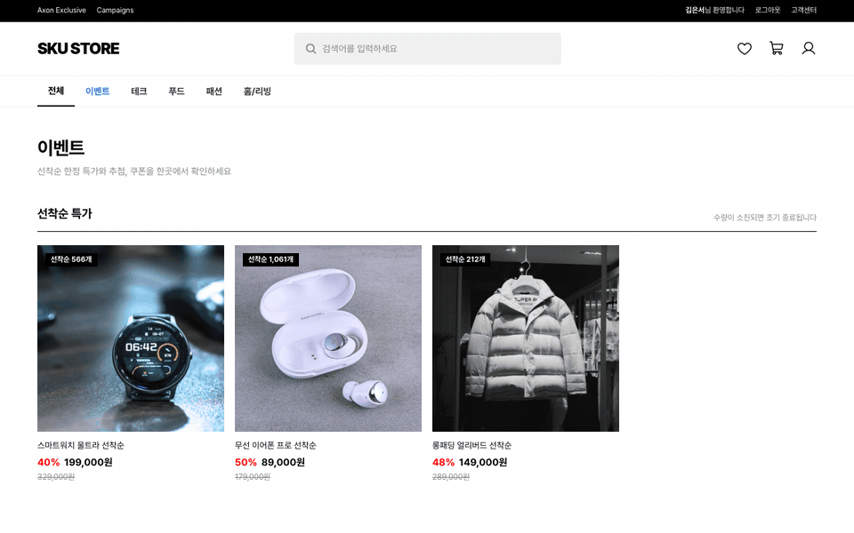
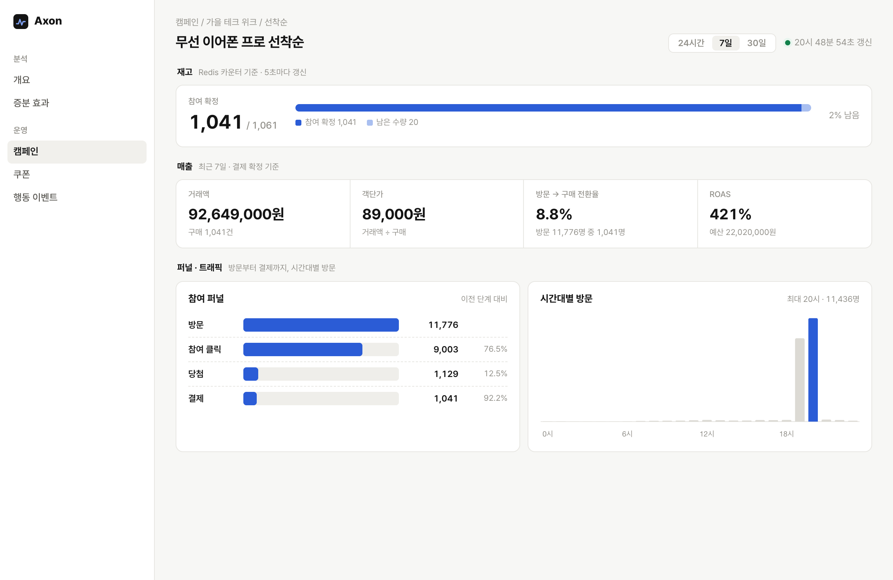
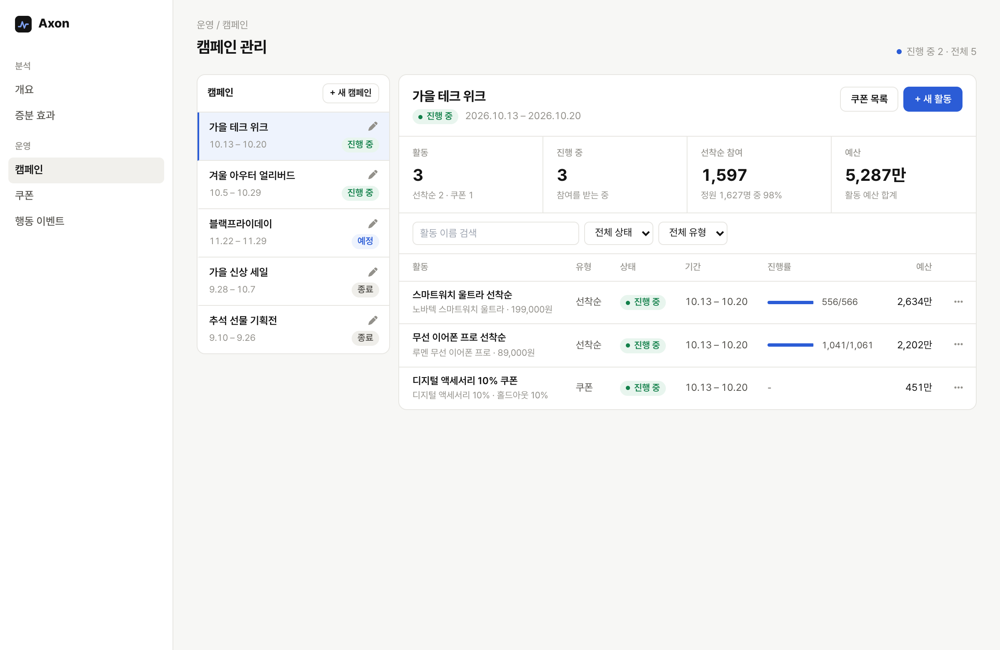
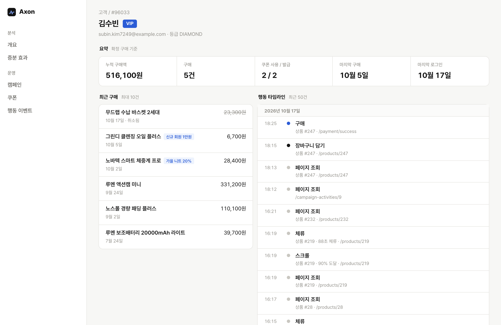
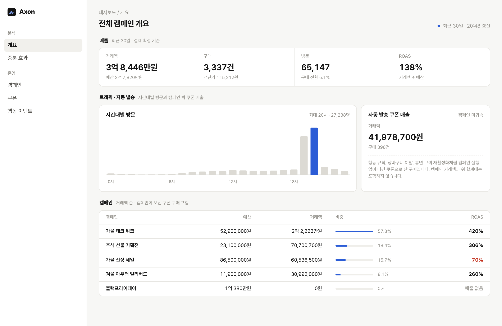
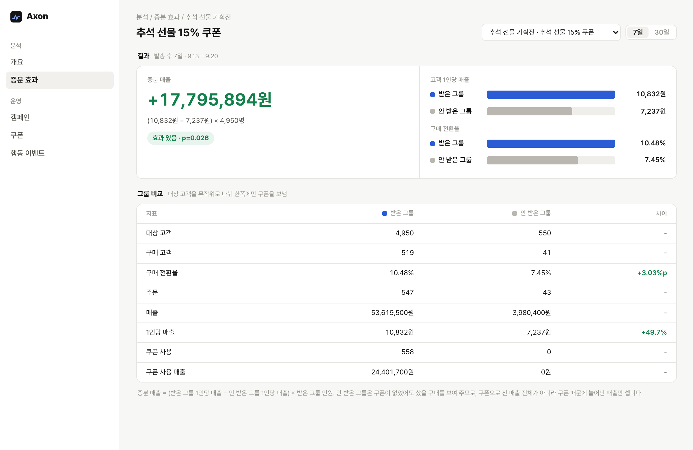
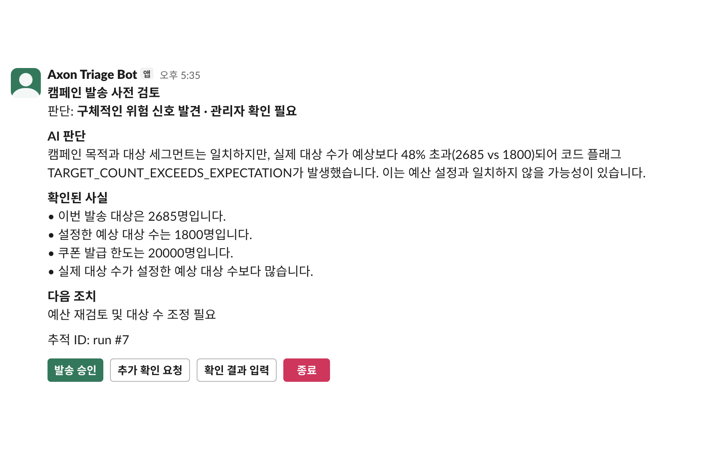
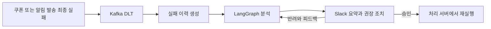
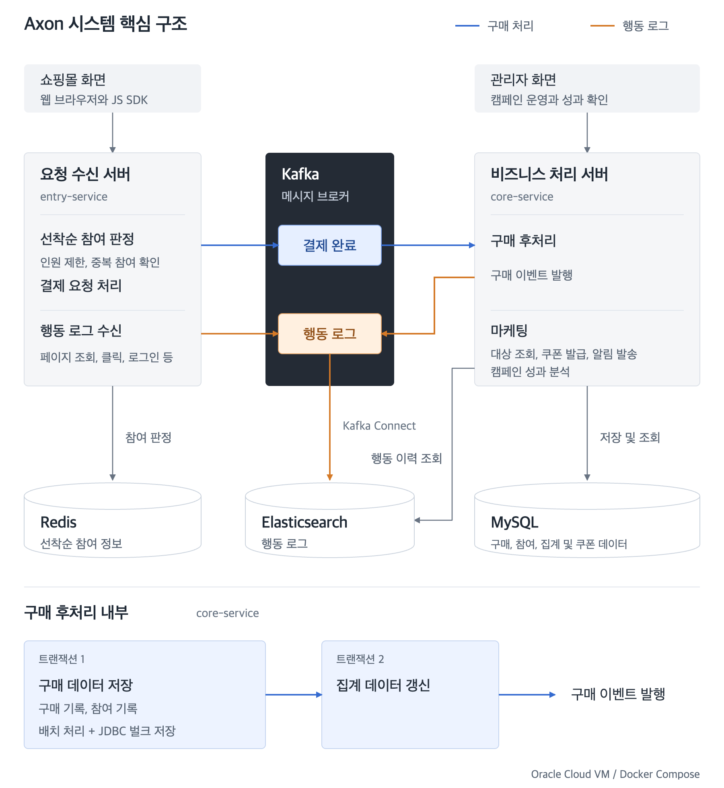

<div align="center">

# 선착순 판매와 행동 데이터 마케팅 플랫폼

커머스에서 일어나는 구매, 조회, 장바구니 같은 고객 행동을 수집해 쿠폰과 알림 캠페인, 성과 분석에 쓰는 마케팅 파이프라인입니다.<br>
그중 트래픽이 가장 몰리는 선착순 판매를 안정적으로 처리하는 데 집중했습니다.



<sub>선착순 상품 응모부터 결제 완료까지. 결제가 확정되면 Kafka를 거쳐 처리 서버가 구매를 기록합니다.</sub>

</div>

---

**목차**

- [주요 기능](#주요-기능)
- [시스템 구조](#시스템-구조)
- [성능 개선 결과](#성능-개선-결과)
- [기술적으로 집중한 문제](#기술적으로-집중한-문제)
- [기술 스택](#기술-스택)
- [실행 방법](#실행-방법)

---

## 주요 기능

### 1. 선착순 구매

몰리는 응모를 Redis에서 원자적으로 판정하고, 결제가 끝나면 나머지 처리는 Kafka로 넘겨 바로 응답합니다. 운영자는 남은 재고와 방문부터 결제까지의 퍼널을 실시간으로 봅니다.

<p align="center">

</p>

### 2. 행동 기반 마케팅

JS SDK와 서버에서 모은 행동 로그로 대상을 골라 쿠폰과 알림을 보냅니다. 캠페인 안에서는 세그먼트, 장바구니 이탈, 휴면 고객에게 쿠폰을 보내고, 캠페인 밖에서는 행동 규칙을 만족한 고객에게 쿠폰이나 알림을 자동으로 보냅니다.

<table>
<tr>
<td width="50%" valign="top">
<a href="./docs/assets/screens/campaign-management.png"></a><br>
캠페인 관리: 활동별 상태, 정원 대비 참여, 예산
</td>
<td width="50%" valign="top">
<a href="./docs/assets/screens/customer-profile.png"></a><br>
고객 프로필: 구매와 쿠폰 이력, 행동 타임라인
</td>
</tr>
</table>

### 3. 캠페인 성과 분석

쿠폰으로 산 구매를 쿠폰, 발송 기록, 캠페인 순으로 따라가 캠페인 매출에 넣고 ROAS를 계산합니다. 쿠폰을 받지 않은 그룹(홀드아웃)과 비교해 쿠폰 때문에 늘어난 매출만 따로 봅니다.

<table>
<tr>
<td width="50%" valign="top">
<a href="./docs/assets/screens/overview.png"></a><br>
전체 캠페인 개요: 최근 30일 거래액과 캠페인별 ROAS
</td>
<td width="50%" valign="top">
<a href="./docs/assets/screens/incrementality.png"></a><br>
쿠폰 증분 효과: 받은 그룹과 받지 않은 그룹의 1인당 매출 비교
</td>
</tr>
</table>

### 4. 운영 AI 에이전트

대량 발송 전에 대상 수, 예산, 세그먼트가 맞는지 점검하고, 발송이 끝내 실패하면 이전 실패 이력과 함께 원인을 정리합니다. 관리자가 Slack에서 승인해야 발송하거나 다시 실행합니다(Human-in-the-Loop).

<p align="center">

</p>

<details>
<summary>발송 실패 분석 흐름</summary>



</details>

---

## 시스템 구조



**구매 처리**
요청 수신 서버(`entry-service`)가 Redis에서 선착순 참여를 판정하고 결제 요청을 처리합니다. Kafka로 전달된 구매 후처리는 비즈니스 처리 서버(`core-service`)가 담당합니다. 구매 기록과 참여 기록은 배치 단위의 한 트랜잭션에서 JDBC 벌크 저장하고, 집계 데이터는 별도 트랜잭션에서 갱신한 뒤 구매 이벤트를 발행합니다.

**마케팅**
행동 로그는 Kafka Connect를 거쳐 Elasticsearch에 적재해 발급 대상 조회에 활용하고, 구매와 쿠폰 기반의 캠페인 성과는 MySQL에서 조회합니다. 대량 쿠폰 발급은 AI 검토와 Slack 관리자 승인을 거쳐 실행합니다.

**서버를 늘려도 깨지지 않게 만든 장치**

현재는 VM 한 대에서 Docker Compose로 운영하지만, 두 서버 모두 여러 대로 늘려도 결과가 달라지지 않도록 만들었습니다.

| 장치 | 막는 문제 |
|---|---|
| Redis 원자적 재고 판정 (Lua) | 요청 수신 서버가 여러 대여도 정원을 넘겨 팔지 않음 |
| 스케줄러 분산 락 (Redisson) | 처리 서버를 늘려도 쿠폰과 휴면 고객 작업이 두 번 돌지 않음 |
| Kafka Consumer Group | 처리 서버 여러 대가 메시지를 나눠 받고, 한 메시지는 한 곳에서만 처리 |
| 멱등 처리 | 같은 메시지가 다시 와도 기록이나 발송이 중복되지 않음 |

---

## 성능 개선 결과

<table>
<tr>
<td align="center" width="25%"><h3>63%</h3></td>
<td align="center" width="25%"><h3>p95 500ms</h3></td>
<td align="center" width="25%"><h3>77 → 956 TPS</h3></td>
<td align="center" width="25%"><h3>2.2배</h3></td>
</tr>
<tr>
<td align="center" valign="top">선착순 API p95 단축<br>Lua 원자 연산</td>
<td align="center" valign="top">1,000 RPS에서 유지<br>Virtual Thread, Kafka</td>
<td align="center" valign="top">Consumer 처리량<br>배치 처리와 JDBC 벌크 저장</td>
<td align="center" valign="top">쿠폰 발급량<br>복합 인덱스</td>
</tr>
</table>

<sub>설계 기준: 선착순 구매 1,000 RPS (4 OCPU, 24GB, 한 대)<br>
Consumer 측정: 단일 Core 인스턴스, 1.2 CPU, 3 GiB, Kafka 소비 스레드 1개. 단건 처리와 배치·벌크 저장 비교.</sub>

---

## 기술적으로 집중한 문제

**트래픽 및 설계 기준**: 선착순 구매 이벤트시 1000RPS, 900TPS(4 OCPU, 24GB)

- 선착순 구매 API의 처리량 및  응답속도를 확보하기 위해, Virtual Thread 도입 및 후속 작업은 Kafka로 비동기 처리구조 설계→ 1000RPS peak, p95 500ms 확보
- 선착순 구매 API에서, 동시 요청으로 초과 판매가 발생하고 장애 시 일부 Redis 연산만 반영되는 문제 발생. Redis INCR로 수량을 제한하고 Lua로 중복 확인과 수량 갱신을 원자적으로 처리 → 초과 판매와 데이터 불일치 해결, Redis 낙관적 락 대비 API 응답시간 63% 단축
- 장바구니 이탈 고객 대상 쿠폰 발송 시, 대상 조회 병목으로 발송 지연 발생. EXPLAIN ANALYZE 기반 복합 인덱스 최적화 → 단위 시간당 발급량 2.2배 개선
- 결제 완료 메시지를 처리하는 Kafka Consumer에서, 메시지별 DB 저장과 커밋으로 처리량 저하. 배치 단위 트랜잭션 처리와 JDBC 벌크 저장 적용 → 단일Consumer에서 처리량 77→956 TPS
- JS SDK와 서버 이벤트 기반 행동 로그 수집 및 Elasticsearch 적재 파이프라인 구축. 쿠폰 발급과 알림 자동화 및 대조군 비교 등 캠페인 성과 분석 대시보드 개발
- 대량 쿠폰발급 등 마케팅 캠페인시 휴먼 에러를 검토하는 FastAPI LangGraph 에이전트 개발, Slack에서 운영자가 확인하는 Human-in-the-Loop 승인 구현
- OpenTelemetry기반 APM과 Prometheus로 인프라,앱 병목해결. 주요 API 응답 68%개선. Github Actions CI/CD 구축

---

## 기술 스택

| | |
|---|---|
| **언어, 런타임** | Java 21, Virtual Thread, Spring Boot |
| **저장소** | MySQL, Redis, Elasticsearch |
| **메시징** | Kafka |
| **AI 에이전트** | FastAPI, LangGraph |
| **인프라** | Docker Compose, Oracle Cloud, GitHub Actions |
| **관측** | OpenTelemetry, Jaeger, Prometheus, Grafana |

---

## 실행 방법

```bash
cp .env.compose.example .env
docker compose -f compose.app.yml up -d --build
```

```bash
curl http://127.0.0.1:8080/actuator/health
curl http://127.0.0.1:8081/actuator/health
```

분석 파이프라인은 아래 compose 파일을 함께 사용합니다.

```bash
docker compose -f compose.app.yml -f compose.analytics.yml up -d
```

메트릭과 추적 화면은 아래 compose 파일을 함께 사용합니다.

```bash
docker compose -f compose.app.yml -f compose.metrics.yml -f compose.otel.yml up -d
```
